# 🇵🇦 Sismos Panamá - Monitor Sismológico y Tectónico en Vivo

[](https://github.com/JTR01D/App-Sismos-Panama/actions/workflows/build-apk.yml)
[](https://github.com/JTR01D/App-Sismos-Panama/releases/latest)
[](https://kotlinlang.org/)
[](https://developer.android.com/jetpack/compose)
[](https://android.com)

Aplicación nativa para Android diseñada para el monitoreo, alerta temprana, divulgación geocientífica y simulación física de eventos sísmicos **en tiempo real y con cobertura focalizada en la República de Panamá**, integrando los datos oficiales del **Instituto de Geociencias de la Universidad de Panamá (IGC-UP)**, la red sismológica internacional **USGS** y la cartografía geológica de fallas corticales activas del istmo.

---

## 🚀 Descarga Directa e Instalación

No requieres compilar el código fuente para disfrutar de la aplicación en tu dispositivo:

### 📥 Descarga del APK Oficial (Público y Directo)
👉 **[Descargar SismosPanama.apk (Última Versión Estable)](https://github.com/JTR01D/App-Sismos-Panama/releases/download/latest/SismosPanama.apk)**

* **Actualizaciones Directas en la App**: La aplicación cuenta con un módulo interno que comprueba los nuevos lanzamientos publicados en este repositorio y permite descargar la nueva versión con un solo toque desde la sección **Acerca de**.
* Consulta el historial de mejoras en la sección de **[Releases](../../releases/latest)**.

---

## 📱 Recorrido Visual y Funcional de la Aplicación

La aplicación está diseñada bajo una arquitectura visual responsiva con estética **Obsidian Slate & Liquid Glass**, optimizada para adaptarse fluidamente tanto a **dispositivos móviles (smartphones)** como a **pantallas de gran formato (tablets)** en orientación vertical u horizontal.

---

### 1. Pantalla Principal: Feed Sísmico en Vivo y Paneles Colapsables
La pantalla principal ofrece un flujo dinámico de eventos en tiempo real. Dispone de un panel colapsable inteligente que permite contraer o expandir la lista de sismos para maximizar el área visible. La interfaz incorpora barras superior e inferior translúcidas (*acrylic / frosted glass*) con efecto de desenfoque dinámico (*blur*), permitiendo que la lista de sismos fluya elegantemente por debajo de los controles sin obstruir la navegación.

| Vista Móvil (Smartphone - Panel Contraído) | Vista Móvil (Smartphone - Panel Expandido) | Vista Tablet (Gran Formato) |
| :---: | :---: | :---: |
| 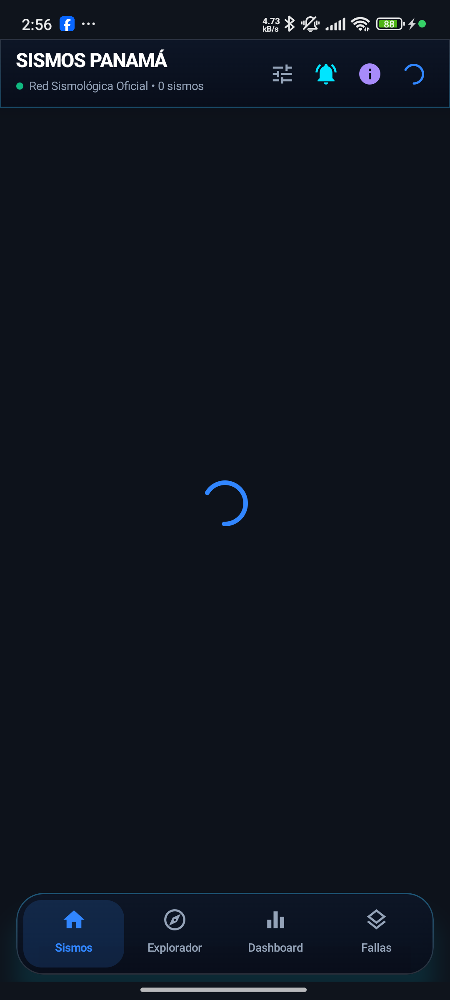 | 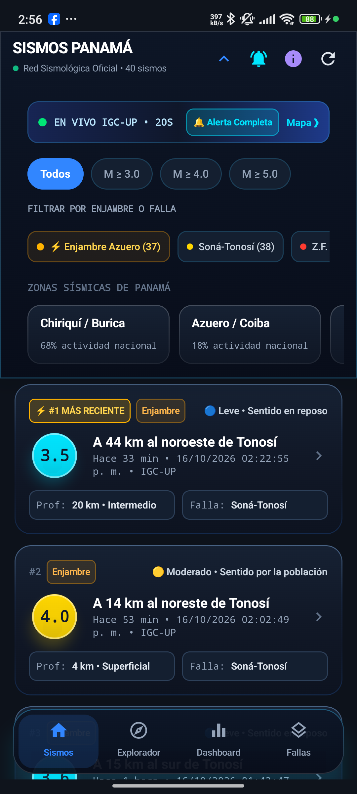 | 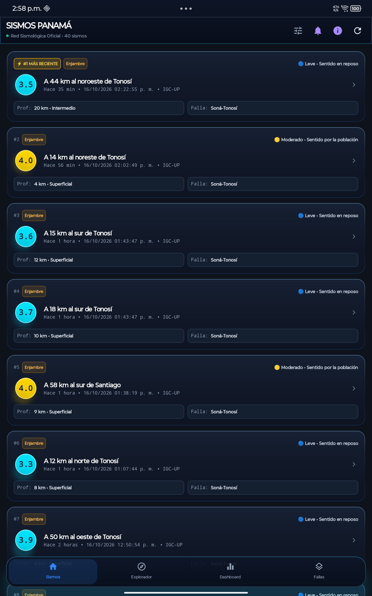 |

---

### 2. Explorador Tectónico 2D & Detector Inteligente de Enjambres
Cartografía interactiva georreferenciada con fallas geológicas activas (Falla Soná-Tonosí, Zona de Fractura de Panamá, Falla de Limón, Falla de Pedro Miguel y Miraflores). Cuando el algoritmo detecta un enjambre sísmico en curso (ej. Península de Azuero), despliega automáticamente una píldora flotante destacada con botón de acceso directo al sismo más reciente (`★ #1 RECIENTE`) y control de descarte rápido (`X`). Incluye un selector interactivo compacto de peligro sísmico (*bolita scrubber*) y paneles colapsables.

| Vista Móvil (Smartphone) | Vista Tablet (Gran Formato) |
| :---: | :---: |
| 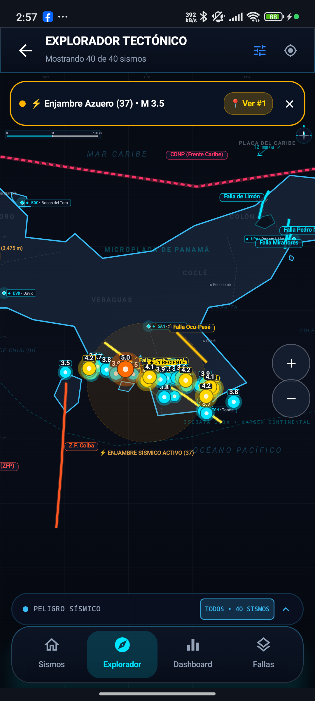 | 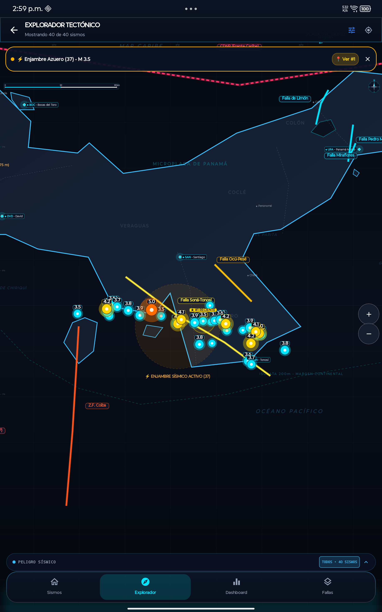 |

---

### 3. Simulador Físico de Propagación de Ondas P & S
Simulador animado interactivo que calcula en tiempo real la dispersión de ondas primarias (longitudinales de compresión, $V_p \approx 6.0\text{ km/s}$) y ondas secundarias (transversales de cizalla, $V_s \approx 3.5\text{ km/s}$) adaptadas a la corteza panameña. Presenta atenuación física por distancia y un cronómetro con los tiempos de arribo e intensidad esperada en las principales ciudades del país (David, Santiago, Chitré, Penonomé, Ciudad de Panamá).

<div align="center">
  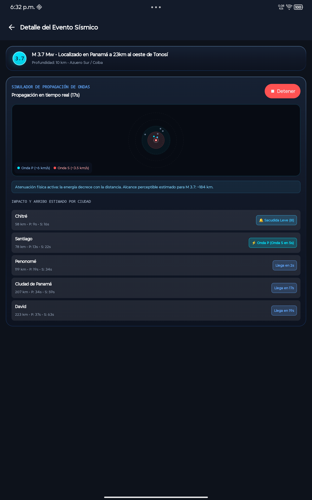
</div>

---

### 4. Dashboard de Geodinámica & Estadísticas en Vivo
Centro analítico con métricas cuantitativas actualizadas al instante: conteo de sismos por ventana temporal (24 horas, 7 días, 30 días o catálogo completo), magnitud máxima registrada, clasificación hipocentral (sismos superficiales $< 20\text{ km}$ vs intermedios/profundos) y porcentajes de concentración sísmica regional.

| Vista Móvil (Smartphone) | Vista Tablet (Gran Formato) |
| :---: | :---: |
| 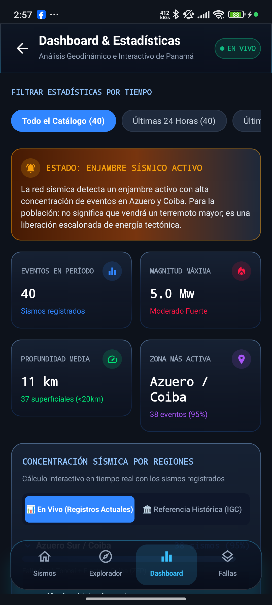 | 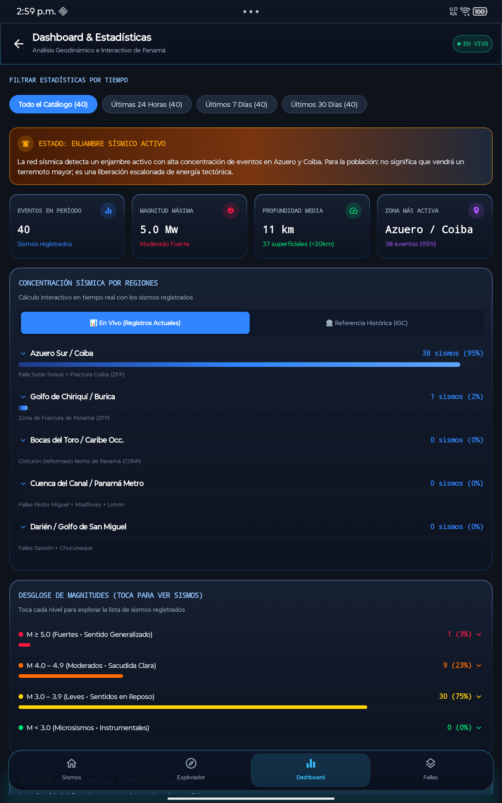 |

---

### 5. Catálogo Geotectónico Estructural de Fallas de Panamá
Módulo educativo y de divulgación geológica que expone las principales estructuras sismogénicas del país. Cada falla incluye su ficha técnica detallada: mecanismo tectónico (rumbo dextral/sinestral, transpresivo, inverso), tasa de desplazamiento cortical (*slip rate* en mm/año), período de recurrencia estimado, régimen de peligrosidad y coordenadas representativas.

| Vista Móvil (Smartphone) | Vista Tablet (Gran Formato) |
| :---: | :---: |
| 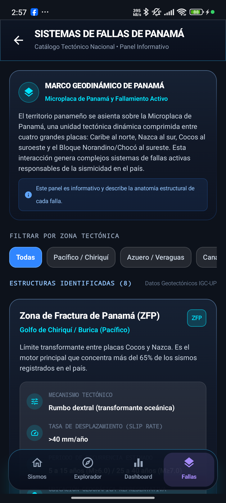 | 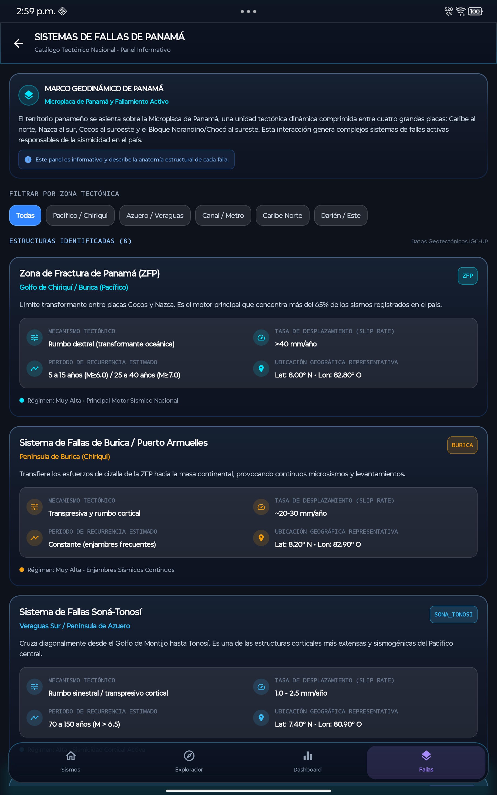 |

---

### 6. Centro de Alertas y Sistema de Actualizaciones In-App
* **Gestor de Notificaciones y Umbrales**: Control granular continuo con deslizador táctil (*slider*) para definir la magnitud mínima de activación (de 2.0 a 6.5+), perfiles rápidos (Completa, Solo Sonido, Solo Vibración, Solo Mensajes, Silencio) y un botón de prueba de sirena y vibración en vivo.
* **Módulo de Actualizaciones de GitHub**: Verifica en segundo plano la existencia de nuevas versiones publicadas en el repositorio mediante la API oficial de GitHub Releases, permitiendo descargar el instalador APK directamente.

| Gestor de Alertas Sísmicas (Control de Umbral) | Actualizaciones In-App (GitHub Releases) |
| :---: | :---: |
| 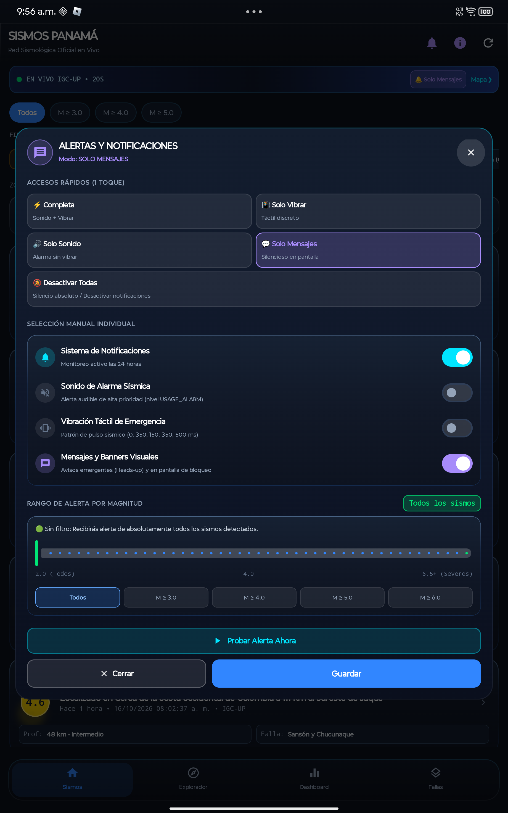 | 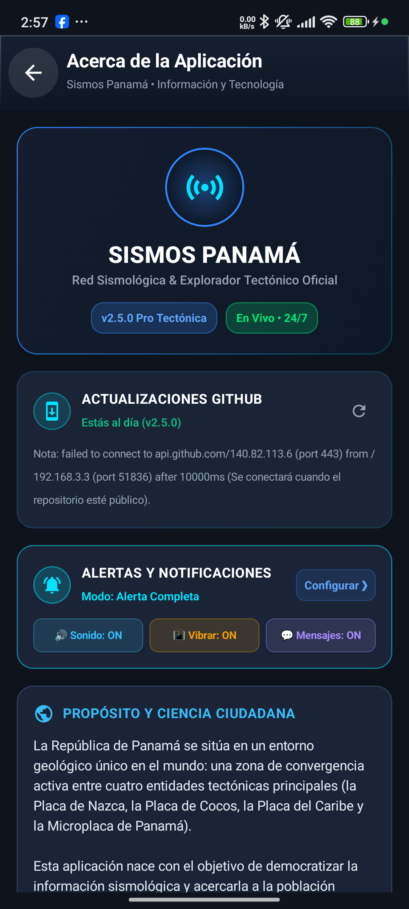 |

---

## ✨ Características Técnicas Principales

### ⚡ Monitoreo Sísmico Dual Exclusivo para Panamá
* **Fuentes de Datos Oficiales Integradas**: Conexión primaria al portal del **Instituto de Geociencias (IGC-UP)** con respaldo satelital automático a la red **USGS** filtrado por el *Bounding Box* del territorio y aguas panameñas:
  * Latitud: `[6.5° N - 10.3° N]`
  * Longitud: `[-83.5° O - -77.0° O]`
* **Geolocalización Inmediata**: Cálculo instantáneo de distancia geodésica a las principales ciudades del país.
* **Clasificación Geodinámica**: Diferenciación de profundidad hipocentral (Superficial $< 20$ km, Intermedia o Profunda).

### 🔔 Sistema de Alertas Inteligente & Coordinador Anti-Duplicados
* **Deduplicación Cruzada Espacio-Temporal (IGC-UP ↔ USGS)**: Evita alertas repetidas cuando la red alterna entre ambas fuentes. Reconoce el mismo evento físico si coincide dentro de 80 km, 20 minutos y $\pm 1.2$ de magnitud.
* **Filtro de Frescura de Emergencia (Máximo 20 minutos)**: Si el dispositivo pierde conectividad y la recupera horas después, **no se disparan sirenas retroactivas de sismos pasados**.
* **Protección de Inicio en Frío**: Sin falsas alarmas retroactivas al instalar o abrir la app por primera vez.
* **Control Continuo del Rango de Magnitud**: Deslizador continuo de `2.0` a `6.5+` con saltos de `0.1` e insignias dinámicas de severidad.
* **Modalidad de Alertas 24/7**: Solo Sonido, Solo Vibración, Solo Mensajes, Completo o Silencio.

### 🌐 Actualizaciones Automáticas In-App
* **Repositorio de Actualizaciones (`UpdateRepository`)**: Consulta asíncrona a la API de GitHub Releases sin bloquear la interfaz.
* **Comparador de Versiones Semánticas**: Notifica al usuario únicamente cuando hay una versión superior a la instalada.
* **Descarga e Instalación Directa**: Enlace directo al archivo APK alojado en GitHub Releases con tamaño formateado en megabytes.

---

## 🛠️ Arquitectura del Proyecto

```text
app/src/main/
├── AndroidManifest.xml                  // Permisos, receivers, workers y servicios
├── assets/
│   ├── leaflet/                         // Librería Leaflet offline embebida
│   └── map.html                         // Lienzo interactivo del mapa sismológico
├── java/com/sismos/panama/
│   ├── MainActivity.kt                  // Actividad principal y navegación Compose
│   ├── SismosPanamaApp.kt               // Inicialización de canales de notificación y WorkManager
│   ├── data/
│   │   ├── api/
│   │   │   ├── SeismicApiService.kt     // Cliente Retrofit con Bounding Box de Panamá
│   │   │   └── RetrofitClient.kt        // OkHttp con timeouts y manejo de red
│   │   ├── background/
│   │   │   ├── SeismicAlertCoordinator.kt // Coordinador central anti-duplicados y frescura
│   │   │   ├── SeismicAlarmReceiver.kt  // Despachador de alarmas y notificaciones exactas
│   │   │   ├── SeismicBootReceiver.kt   // Auto-reinicio de monitoreo al reiniciar el sistema
│   │   │   └── SeismicMonitorWorker.kt  // Tarea de respaldo periódica con WorkManager
│   │   ├── models/
│   │   │   ├── AlertSettings.kt         // Preferencias guardadas de sonido, vibración y umbral
│   │   │   ├── AppUpdateInfo.kt         // Modelo de datos para actualizaciones de GitHub
│   │   │   ├── Earthquake.kt            // Modelo de dominio y cálculos geodésicos
│   │   │   ├── FaultLine.kt             // Catálogo estructurado de fallas tectónicas
│   │   │   ├── PanamaRegion.kt          // Polígonos y regiones sismotectónicas
│   │   │   └── UsgsDto.kt               // Deserializadores GeoJSON FDSN
│   │   └── repository/
│   │       ├── EarthquakeRepository.kt  // Parser robusto IGC-UP, fallback USGS y distancias
│   │       └── UpdateRepository.kt      // Consulta a GitHub Releases API y descarga de APK
│   └── ui/
│       ├── components/
│       │   ├── EarthquakeCard.kt        // Tarjeta interactiva con indicadores de riesgo
│       │   ├── GlassCard.kt             // Contenedor translúcido con efecto cristal esmerilado
│       │   ├── MagnitudeBadge.kt        // Distintivo cromático por magnitud Richter
│       │   ├── NotificationSettingsModal.kt // Modal con Slider continuo de magnitud y chips
│       │   ├── PanamaBottomNavigationBar.kt // Barra de navegación inferior flotante Liquid Glass
│       │   └── PanamaRegionsBanner.kt   // Chips de filtrado rápido regional
│       ├── screens/
│       │   ├── HomeScreen.kt            // Feed sísmico principal en vivo con paneles colapsables
│       │   ├── DetailScreen.kt          // Análisis sismotectónico y simulación de ondas P & S
│       │   ├── FaultsScreen.kt          // Catálogo técnico de fallas y glosario
│       │   ├── DashboardScreen.kt       // Estadísticas, gráficos y análisis de enjambres
│       │   ├── InteractiveMapScreen.kt  // Explorador tectónico 2D con detección de enjambres
│       │   └── AboutScreen.kt           // Acerca de la app, actualizador GitHub y fuentes oficiales
│       ├── theme/
│       │   ├── Color.kt
│       │   ├── Theme.kt
│       │   └── Type.kt
│       └── viewmodel/
│           └── SeismicViewModel.kt      // Estado reactivo y auto-recarga cada 15 segundos
└── res/
    ├── drawable/
    ├── mipmap-anydpi-v26/
    └── values/
        ├── colors.xml
        ├── strings.xml
        └── themes.xml
```

---

## 📋 Especificaciones Técnicas

| Atributo | Especificación |
| :--- | :--- |
| **Versión Actual** | `2.5.0 Pro Tectónica` (Build 25) |
| **Lenguaje** | Kotlin 2.0.21 (JVM Target 17) |
| **Min SDK** | Android 8.0 Oreo (API 26) |
| **Target / Compile SDK** | Android 15 (API 35) |
| **Framework de UI** | Jetpack Compose + Material Design 3 |
| **Arquitectura** | MVVM (Model-View-ViewModel) + StateFlow Reactivo |
| **Red y API** | Retrofit 2 + Gson + OkHttp 4 + Web Scraping IGC-UP + GitHub Releases API |
| **Monitoreo en Segundo Plano** | SeismicAlertCoordinator + AlarmManager + WorkManager + BroadcastReceiver |
| **Motor Cartográfico** | Leaflet.js embebido en WebView nativo (Assets locales offline) |
| **Permisos de Sistema** | `INTERNET`, `POST_NOTIFICATIONS`, `VIBRATE`, `SCHEDULE_EXACT_ALARM`, `RECEIVE_BOOT_COMPLETED`, `REQUEST_IGNORE_BATTERY_OPTIMIZATIONS` |
| **Seguridad** | Sin rastreadores de terceros, sin telemetría invasiva, 100% código abierto |

---

## 💻 Compilación Local en Android Studio

Si deseas compilar la aplicación en tu propio entorno:

1. **Clonar el Repositorio**:
   ```bash
   git clone https://github.com/JTR01D/App-Sismos-Panama.git
   cd App-Sismos-Panama
   ```
2. **Abrir en Android Studio**:
   * Abre **Android Studio** (Koala / Ladybug o superior con JDK 17).
   * Selecciona **File > Open...** y elige la carpeta raíz del proyecto.
3. **Compilar y Ejecutar**:
   * Conecta tu dispositivo Android con la **Depuración por USB** activada.
   * Compila el APK mediante terminal:
     ```bash
     ./gradlew assembleDebug
     ```

---

## 👨‍💻 Autor y Desarrollador

Desarrollado de forma individual por:

* **JTR01D** ([GitHub: @JTR01D](https://github.com/JTR01D))
* **Repositorio Oficial**: [https://github.com/JTR01D/App-Sismos-Panama](https://github.com/JTR01D/App-Sismos-Panama)

---

## 📄 Licencia

Este proyecto se distribuye bajo los términos de la **Licencia MIT**. Consulta el archivo de licencia para más detalles.
